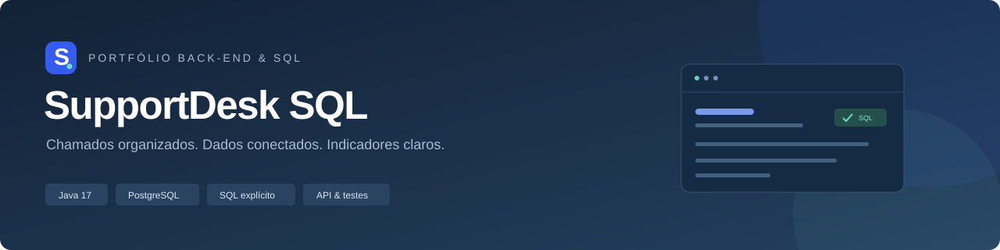
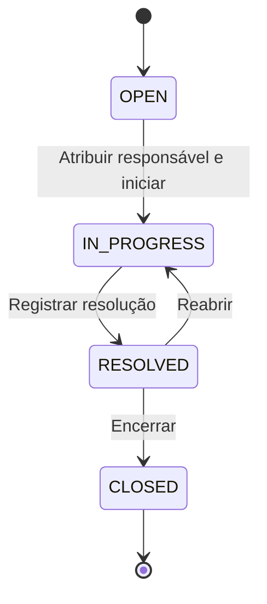

# SupportDesk SQL



**API de chamados de suporte com SQL explícito, PostgreSQL e indicadores verificáveis.**

Java 17 · Spring Boot 4.1.1 · PostgreSQL 17 · JDBC · Flyway · JUnit · GitHub Actions

O projeto conecta um cenário de suporte a sistemas à prática de desenvolvimento back-end e banco de dados. Um chamado é aberto, atribuído, acompanhado e resolvido; cada mudança gera um registro de histórico na mesma transação. Os relatórios consultam os dados persistidos e mostram demanda, carga de trabalho e cumprimento de prazo.

Projeto educacional de portfólio de **César Ricciarelli**. Os nomes, chamados e resultados da demonstração são fictícios; os indicadores não representam uma empresa real.

## Veja o projeto em cinco minutos

1. Instale o Docker Desktop e deixe-o em execução.
2. Extraia o projeto, abra um terminal na pasta deste README e execute:

   ```bash
   docker compose up --build -d
   ```

3. Abra [http://localhost:8080](http://localhost:8080) para visualizar o painel e o histórico dos chamados.
4. Execute os testes em um banco separado:

   ```bash
   docker compose --profile test run --rm tests
   ```

5. Explore as [12 consultas SQL](sql/) e o [guia de estudo](docs/STUDY_GUIDE.md).

O primeiro download das imagens e dependências pode levar alguns minutos. `docker compose logs -f app` mostra a inicialização; a aplicação estará pronta quando [a verificação de saúde](http://localhost:8080/actuator/health) retornar `{"status":"UP"}`.

O painel é de consulta. Abertura, atribuição, comentários, mudanças de status e arquivamento estão disponíveis pela API e nos [exemplos HTTP](docs/requests.http).

## Evidências técnicas

| Competência          | Onde conferir                                                                                      |
| -------------------- | -------------------------------------------------------------------------------------------------- |
| Modelagem relacional | Cinco tabelas, chaves primárias e estrangeiras, identidade, `UNIQUE`, `NOT NULL` e `CHECK`         |
| SQL                  | `JOIN`, `LEFT JOIN`, `GROUP BY`, `HAVING`, `CASE`, agregações, CTE, subconsulta e função de janela |
| Java e REST          | Camadas de aplicação, persistência e HTTP; DTOs validados; paginação; erros estruturados           |
| Transações           | Chamado e histórico persistidos juntos; teste de rollback em falha de gravação do histórico        |
| Concorrência         | `SELECT ... FOR UPDATE` nas alterações; decisões e limites documentados                            |
| Análise de dados     | Demanda por categoria, trabalho por agente e SLA com denominadores explícitos                      |
| Qualidade            | Testes unitários, testes HTTP, verificação de restrições e execução do caderno SQL                 |
| Organização          | Migrações versionadas, Maven Wrapper, contrato OpenAPI e fluxo de CI                               |

## Regras do atendimento



- `CRITICAL` = 4 horas; `HIGH` = 8 horas; `MEDIUM` = 24 horas; `LOW` = 72 horas.
- Os prazos usam horas corridas, incluindo fins de semana. Não há calendário comercial.
- Um solicitante ativo abre o chamado; agentes ativos atribuem responsáveis e alteram status.
- A reabertura remove a resolução anterior dos indicadores atuais e mantém o prazo original.
- A atribuição repetida ao mesmo agente não gera eventos duplicados.
- `DELETE /tickets/{id}` arquiva somente chamados encerrados. O registro e o histórico permanecem no banco, mas saem das listas e dos indicadores operacionais.
- Os papéis `REQUESTER` e `AGENT` são regras de negócio. Informar `actorId` não autentica a pessoa: esta demonstração não implementa login.

## Dados da demonstração

O perfil `demo`, ativado pelo Compose, carrega três departamentos, seis usuários, quatro categorias e oito chamados. O perfil normal cria o esquema vazio.

| Indicador inicial          | Resultado esperado |
| -------------------------- | ------------------ |
| Total não arquivado        | 8 chamados         |
| Fila aberta/em andamento   | 4 chamados         |
| Resolvidos/encerrados      | 4 chamados         |
| Resoluções dentro do prazo | 3 de 4 = 75%       |
| Tempo médio de resolução   | 5 horas            |

O número de chamados abertos com prazo vencido depende do relógio do banco, pois as datas da demonstração são fixas. Os testes não tratam esse número como constante.

## API

O [contrato OpenAPI](src/main/resources/static/openapi.yaml) está disponível também em `http://localhost:8080/openapi.yaml`.

| Método     | Caminho                                  | Operação                            |
| ---------- | ---------------------------------------- | ----------------------------------- |
| GET / POST | `/api/v1/departments`                    | Listar/criar departamentos          |
| GET / POST | `/api/v1/categories`                     | Listar/criar categorias             |
| GET / POST | `/api/v1/users`                          | Listar/criar usuários               |
| GET / POST | `/api/v1/tickets`                        | Listar/abrir chamados               |
| GET        | `/api/v1/tickets/{id}`                   | Consultar chamado e histórico       |
| PATCH      | `/api/v1/tickets/{id}/assignment`        | Atribuir agente                     |
| PATCH      | `/api/v1/tickets/{id}/status`            | Alterar status                      |
| POST       | `/api/v1/tickets/{id}/comments`          | Adicionar comentário                |
| DELETE     | `/api/v1/tickets/{id}?actorId={agentId}` | Arquivar chamado encerrado          |
| GET        | `/api/v1/reports/overview`               | Visão geral                         |
| GET        | `/api/v1/reports/by-category`            | Demanda por categoria               |
| GET        | `/api/v1/reports/by-agent`               | Carga por agente ativo              |
| GET        | `/api/v1/reports/sla`                    | Cumprimento de prazo por prioridade |

A listagem aceita `status`, `priority`, `categoryId`, `agentId`, `q`, `page` e `size`. A primeira página é `0`; `size` vai de `1` a `100`. A busca é por trecho literal do título, sem interpretar `%` e `_` como curingas. A ordenação é fixa por data de criação e ID, decrescentes.

```bash
curl "http://localhost:8080/api/v1/tickets?status=OPEN&priority=HIGH&page=0&size=5"
```

Para abrir um chamado no conjunto de demonstração:

```bash
curl -X POST http://localhost:8080/api/v1/tickets \
  -H "Content-Type: application/json" \
  -d '{"title":"Investigar consulta lenta","description":"Analisar o relatório fictício de estoque.","requesterId":1,"categoryId":2,"priority":"HIGH"}'
```

A resposta contém `ticket.id`, `ticket.dueAt` e `history`. Use o novo ID nos próximos exemplos; os agentes ativos da demonstração têm IDs `3`, `4` e `5`.

## Execução com Java e testes

Com JDK 17 ou superior e somente o banco em Docker:

```bash
docker compose up -d db
bash ./mvnw --batch-mode --no-transfer-progress clean verify
bash ./mvnw spring-boot:run -Dspring-boot.run.profiles=demo
```

No Windows, use `mvnw.cmd` em vez de `bash ./mvnw`. Para testar, não é necessário iniciar o serviço `app`.

A suíte de integração exige `supportdesk_test`, recusa outro nome de banco e limpa as tabelas somente desse banco de testes. Se o PostgreSQL não estiver disponível, `verify` falha; não há substituição silenciosa por H2.

| Variável                                        | Padrão local                                        |
| ----------------------------------------------- | --------------------------------------------------- |
| `DB_URL`                                        | `jdbc:postgresql://localhost:5433/supportdesk`      |
| `DB_USER` / `DB_PASSWORD`                       | `supportdesk` / `local_demo_only`                   |
| `TEST_DATABASE_URL`                             | `jdbc:postgresql://localhost:5433/supportdesk_test` |
| `TEST_DATABASE_USER` / `TEST_DATABASE_PASSWORD` | `supportdesk` / `local_demo_only`                   |
| `TEST_DATABASE_POOL_SIZE`                       | `2`                                                 |
| `APP_PORT` / `DB_PORT`                          | `8080` / `5433`, para o Compose                     |

Os valores de exemplo são públicos e destinados ao uso local. Copie `.env.example` para `.env` se precisar mudá-los; `.env` não é versionado.

Se o volume já existia antes da criação de `supportdesk_test`, crie o banco separado com `docker compose exec db psql -U supportdesk -d supportdesk -c "CREATE DATABASE supportdesk_test;"`. O script de inicialização só roda na criação do volume. Não é necessário apagar dados para testar.

Relatórios: `target/surefire-reports` e `target/failsafe-reports`. Cobertura: `target/site/jacoco/index.html`; o projeto não anuncia uma porcentagem sem medi-la.

## Documentação

- [Modelo de dados](docs/DATA_MODEL.md)
- [Decisões de arquitetura](docs/ARCHITECTURE.md)
- [Caderno SQL](sql/README.md)
- [Guia para explicar o projeto](docs/STUDY_GUIDE.md)
- [Resultado e limites da verificação](docs/VERIFICATION.md)
- [Exemplos de requisições](docs/requests.http)

As consultas da API ficam em `persistence/` e `src/main/resources/sql/reports/`. Não há ORM gerando o SQL. O caderno `sql/` complementa os relatórios com exercícios executáveis.

## Escopo

Demonstração local sem autenticação, autorização por sessão, anexos, notificações, pesquisa por texto completo ou calendário de dias úteis. Os serviços do Compose expõem portas apenas em `127.0.0.1`. Uso público com dados reais exige um projeto próprio de implantação e segurança.

O GitHub Actions executará `clean verify` com PostgreSQL quando o repositório for publicado. A existência do arquivo de CI não comprova uma execução remota.

## English overview

SupportDesk SQL is an educational support-ticket API with explicit JDBC queries, PostgreSQL relational modeling, transactional audit history and SQL-based operational analytics. It includes a read-only dashboard, a 12-query SQL workbook, OpenAPI documentation and HTTP/database integration tests. All demo identities and metrics are fictional.

## Licença

[MIT](LICENSE). Autor: César Ricciarelli.
