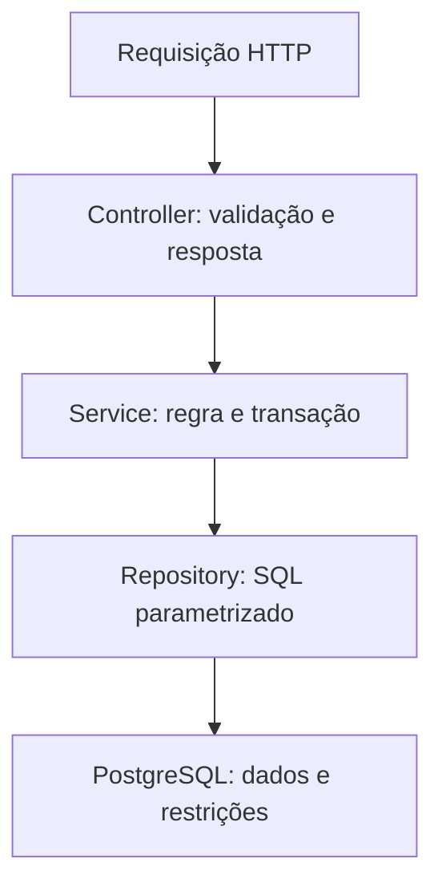

# Decisões de arquitetura

## Fluxo

O domínio define prioridades e transições. DTOs usam records; validação de entrada não substitui restrições do banco. O `Clock` é injetado para separar o cálculo de prazos do relógio global.

## JDBC e parâmetros

O objetivo é tornar as consultas SQL visíveis. `NamedParameterJdbcTemplate` vincula os valores recebidos como parâmetros. Nomes de colunas e ordenação não vêm do usuário.

Na busca por título, `%`, `_` e a barra invertida são escapados, mantendo uma busca literal. Enums, IDs e paginação são validados antes da consulta.

## Transação e histórico

Criação, atribuição, transição e arquivamento usam `@Transactional`. A alteração e o evento pertencem à mesma transação. O teste de rollback instala um gatilho que rejeita o evento e confirma a permanência do status anterior.

Para alterar um chamado, o serviço bloqueia sua linha com `SELECT ... FOR UPDATE` antes de ler o estado. Requisições concorrentes precisam reavaliar o status após obter o bloqueio. A suíte desta entrega não é um teste de carga nem comprova comportamento distribuído.

O isolamento padrão do PostgreSQL é mantido. Os dados podem mudar entre páginas ou entre requisições de relatórios. O painel não representa um snapshot transacional único de todos os cartões.

## Indicadores

- `overview.sql`: agrega o universo não arquivado.
- `by-category.sql`: preserva categorias sem registros com `LEFT JOIN`.
- `by-agent.sql`: mantém agentes ativos sem chamados e exclui inativos.
- `sla.sql`: inclui as quatro prioridades e retorna taxa nula sem resoluções.

O tempo de resolução é `resolved_at - created_at`, em horas corridas. Uma reabertura apaga a resolução atual até a nova resolução. Não há métrica de primeira resposta nem medição separada de cada ciclo de reabertura.

## Índices

Os índices atendem ordenação por criação, status, categoria, agente, prazo aberto e histórico. Índices parciais excluem arquivados dos principais caminhos operacionais.

`ILIKE '%termo%'` não é acelerado por um B-tree convencional. Trigramas ou pesquisa por texto completo seriam uma evolução para volumes maiores. Com oito chamados, uma varredura sequencial pode ser a decisão correta.

## Migrações

`V1` cria o esquema; `V2` cria índices. O perfil `demo` acrescenta `V900` com dados fictícios e snapshots, identificados como importação, sem inventar uma sequência completa de atendimento.

Em um banco que recebeu `V900`, mantenha o perfil `demo` para o Flyway encontrar a migração aplicada. Bancos de teste recebem `V1` e `V2`; a suíte recria suas fixtures.

## Limites

`actorId` demonstra histórico e validação de papéis; não autentica a pessoa. A versão local não deve receber informações de uma organização.

Não há microserviços, mensageria ou cache. Eles não são necessários para o problema e dificultariam a inspeção das consultas e transações.
