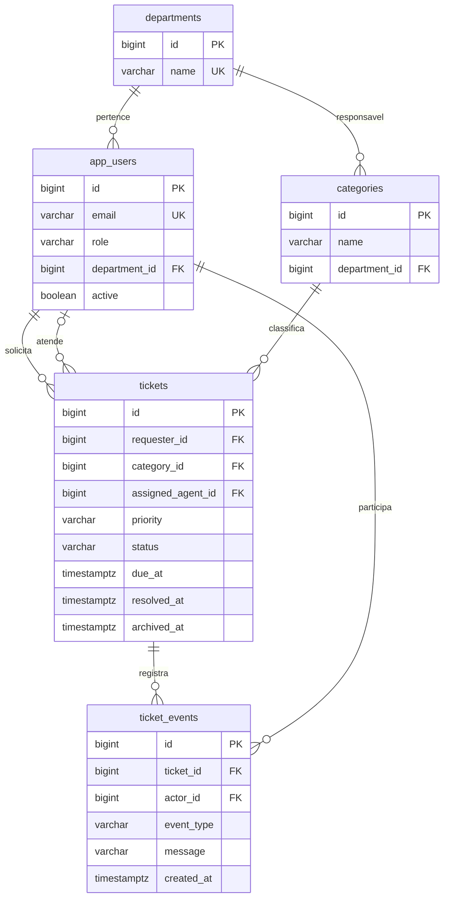

# Modelo relacional

O diagrama destaca relacionamentos. Os campos completos e todas as restrições estão na [migração V1](../src/main/resources/db/migration/V1__create_support_schema.sql).

## Integridade

Nomes de usuários, categorias e departamentos não são copiados no chamado. Os relatórios os obtêm por relacionamento, evitando atualizações repetidas quando um nome muda.

O e-mail é único; a API o normaliza para minúsculas. Categoria tem unicidade composta por departamento e nome. `assigned_agent_id` é opcional.

`CHECK` protege enums, texto vazio e coerência de datas. Resolvidos e encerrados exigem `resolved_at`; somente encerrados possuem `closed_at` e podem ser arquivados.

As chaves estrangeiras asseguram a existência do usuário, mas não seu papel. A regra de solicitante/agente ativo pertence ao serviço. Uma escrita SQL externa pode contornar regras da aplicação e não gera eventos automaticamente.

## Datas e IDs

Datas usam `TIMESTAMPTZ`; a aplicação cria instantes em UTC. O agrupamento por dia converte explicitamente para UTC. A interface mostra datas no fuso do navegador.

IDs são gerados por identidade. Lacunas são normais: sequências não voltam ao valor anterior depois de rollback.
